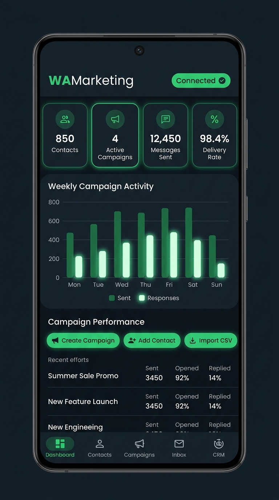
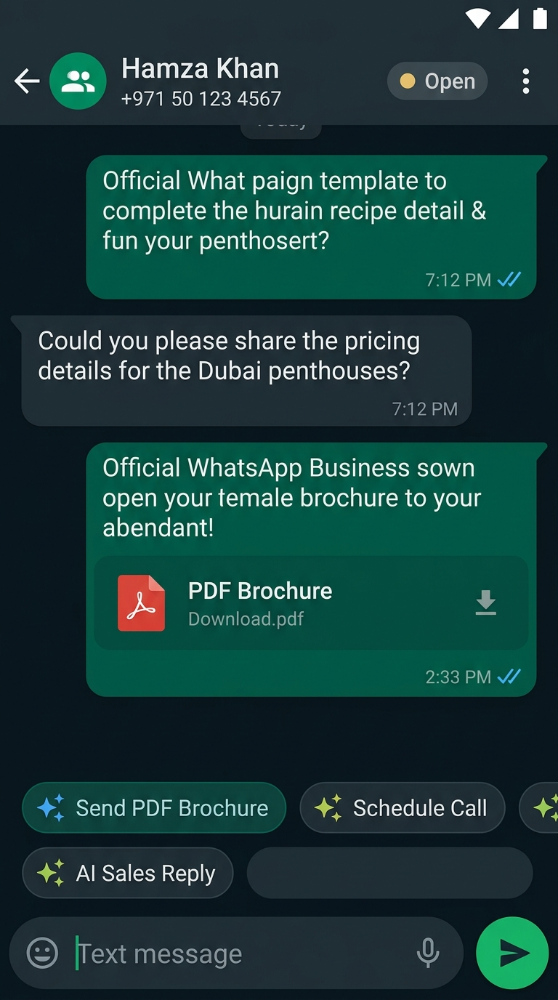
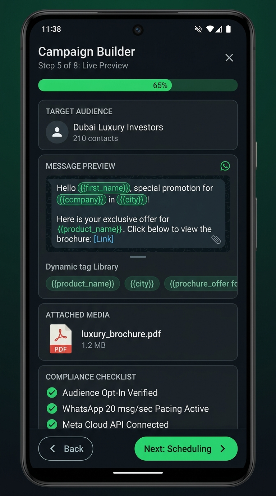
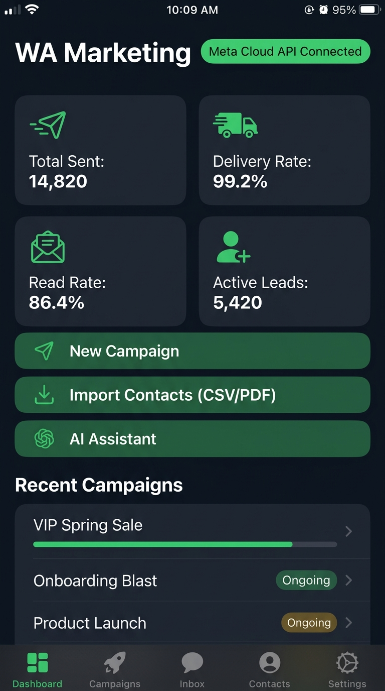
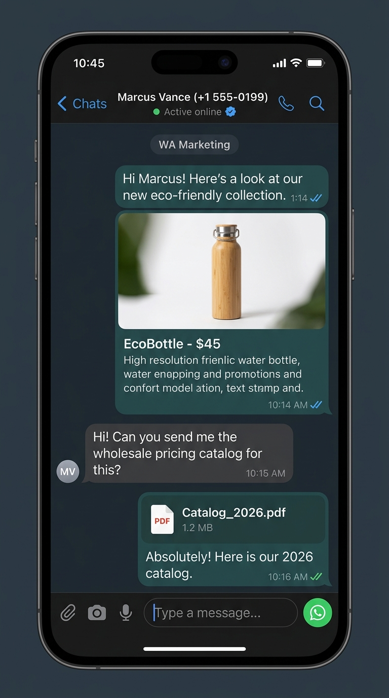
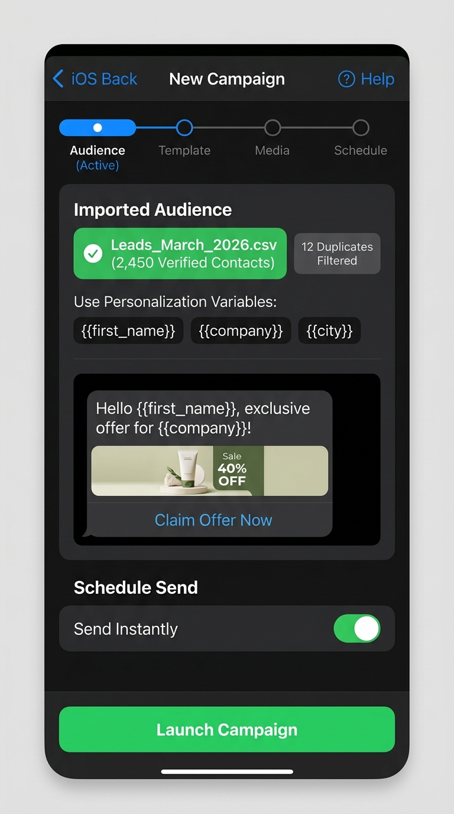
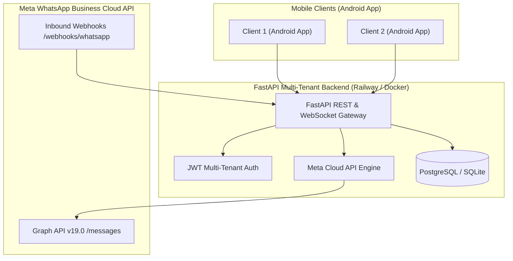

# 🚀 WAMarketing Platform

> **Full-Stack Enterprise WhatsApp Marketing & Engagement Suite**  
> Powered by Meta's Official WhatsApp Cloud API, FastAPI, and Android Jetpack Compose. Multi-Tenant, Zero-PC Tunneling, and Production-Ready.

---

## 📸 Application Showcase

### Android App Experience (Jetpack Compose)
| 📊 Real-Time Analytics & Wallet | 💬 2-Way Real-Time Inbox | 📢 Smart Campaign Builder |
|:---:|:---:|:---:|
|  |  |  |

### Modern Responsive Cross-Platform Design
| 📱 Executive Dashboard | 💬 Live Customer Thread | 🎯 Audience & Template Dispatch |
|:---:|:---:|:---:|
|  |  |  |

---

## ✨ Key Features

### 🏢 1. True Multi-Tenant SaaS Architecture
* **One Central Backend:** Deploy once on Railway, Render, or Docker to host unlimited clients.
* **Per-Client Isolation:** Each client connects their own Meta Phone Number ID, WABA ID, and Permanent Access Token directly within the app.
* **Inbound Dynamic Webhook Routing:** Meta messages automatically route to the corresponding business inbox based on incoming `phone_number_id`.

### 📢 2. Meta WhatsApp Cloud API Marketing
* **Template Creation & Synchronization:** Create Marketing and Utility templates directly in-app, submit to Meta for approval, and sync status in real time.
* **Media & File Attachments:** Attach images, PDF brochures, video guides, and Android APKs directly to campaigns and messages.
* **CSV Audience Import:** Import thousands of customer leads with custom tags and opt-in consent management.

### 💬 3. 2-Way Live Customer Chat
* **Live Inbound Webhooks:** Receive customer replies instantly with delivery receipts (`sent`, `delivered`, `read`).
* **24-Hour Customer Window Tracking:** Adheres strictly to Meta's 24-hour service window policies, offering approved re-engagement templates when windows expire.
* **Quick Replies & Note Taking:** Add internal CRM notes, customer tags, and canned quick responses.

### 💳 4. Client Wallet & Balance Management
* **Multi-Gateway Support:** Simulated & live checkout flows for UPI, Credit/Debit Cards, Stripe, and PayPal.
* **Secure OTP Verification:** Two-step payment confirmation with SMS/email OTP authentication before balance credit.
* **Meta Fee Deduction Engine:** Automatically tracks per-message utility, marketing, and service conversation rates.

---

## 🏗️ Architecture Overview



---

## 🛠️ Tech Stack

* **Backend:** Python 3.11, FastAPI, SQLAlchemy, Alembic, Uvicorn, HTTPX, Pydantic v2
* **Mobile App:** Kotlin, Android Jetpack Compose, Material Design 3, Coroutines & Flow
* **Database:** SQLite (local development) / PostgreSQL (production)
* **Integration:** Meta WhatsApp Cloud API (Graph API v19.0), Cloudflare Tunnels

---

## 🚀 Quick Start Guide

### 1. Run the Backend Locally

```bash
# Clone the repository
git clone https://github.com/your-username/wamarketing.git
cd wamarketing/backend

# Install dependencies
pip install -r requirements.txt

# Run server
uvicorn app.main:app --host 0.0.0.0 --port 8005 --reload
```

* API Health: `http://localhost:8005/health`
* Interactive Swagger Docs: `http://localhost:8005/docs`

### 2. Deploy to Railway in 1-Click

1. Fork or push this repository to your GitHub account.
2. Go to [Railway.app](https://railway.app), click **+ New Project ➔ GitHub Repository**.
3. Select this repository and set the Root Directory to `/backend`.
4. Add the following environment variables:
   ```env
   SECRET_KEY=your_secure_jwt_secret_key
   WHATSAPP_WEBHOOK_VERIFY_TOKEN=wamarketing_secure_verify_token
   DATABASE_URL=sqlite:///./wamarketing.db
   ```
5. Railway will automatically build and assign a permanent HTTPS domain!

### 3. Connect WhatsApp Cloud API in App

1. Open the Android App.
2. Navigate to **Settings ➔ Connect WhatsApp Business Number**.
3. Enter your Meta **Phone Number ID**, **WABA ID**, and **Permanent Access Token**.
4. Set the Webhook Callback URL in Meta Developer Dashboard:
   ```text
   https://your-domain.up.railway.app/api/v1/webhooks/whatsapp
   ```
   * Verify Token: `wamarketing_secure_verify_token`
   * Subscribed fields: `messages`

---

## 📄 License
This project is licensed under the MIT License - see the LICENSE file for details.
