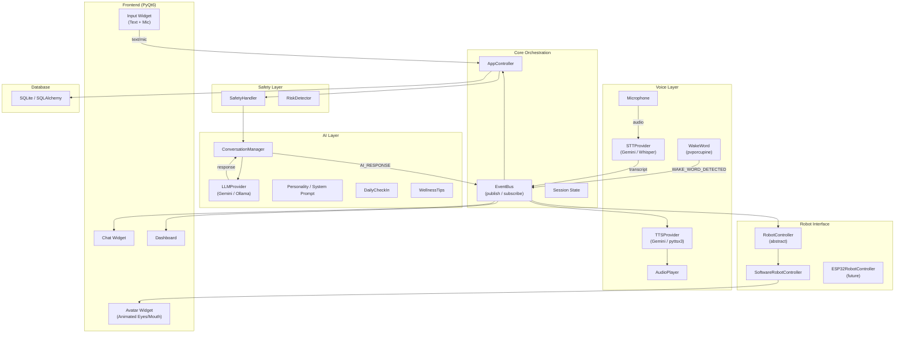
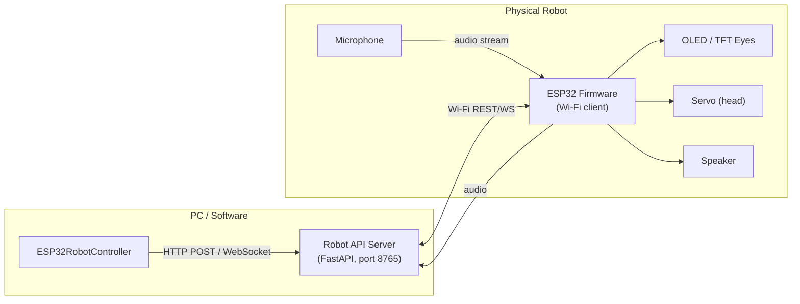
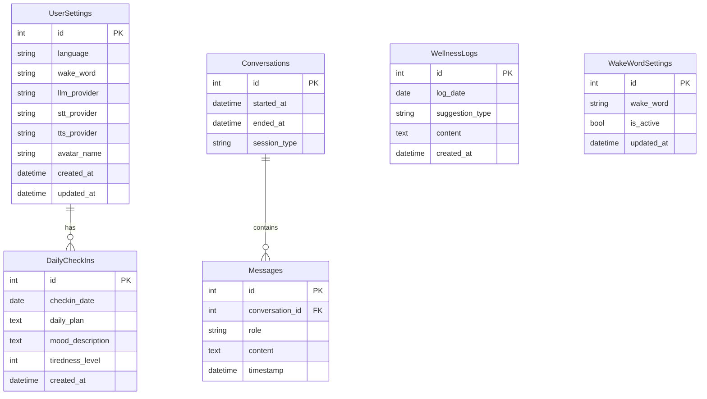
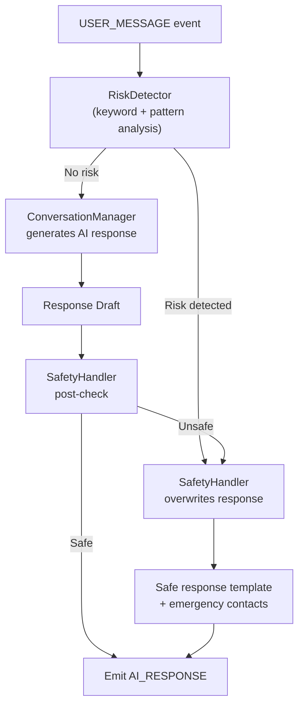
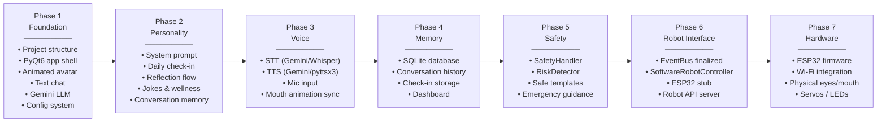

# 🤖 AI Mental Health Assistant — Architecture Proposal

> [!IMPORTANT]
> This document is a proposal for your approval. **Do not implement anything yet.**
> Review, request changes, then approve before Phase 1 begins.

---

## 1. Technology Stack

### Frontend (Desktop UI)

| Layer | Technology | Why |
|---|---|---|
| Framework | **Python + PyQt6** | Native desktop app, no browser overhead, excellent animation support, runs fully offline |
| Avatar Rendering | **Custom Canvas / OpenGL (via PyOpenGL or QPainter)** | Full control over eye/mouth animation without a game engine |
| Charts (Dashboard) | **Matplotlib + PyQtGraph** | Lightweight, no JS needed |
| Styling | **QSS (Qt Style Sheets)** | CSS-like theming for the futuristic look |

> [!NOTE]
> **Alternative considered:** Electron + React. Rejected because it adds Node.js + browser overhead, makes offline-first harder, and complicates future ESP32 API server design. PyQt6 produces a true native executable and is a common FYP stack.

---

### Backend / AI Core

| Layer | Technology | Why |
|---|---|---|
| Language | **Python 3.12** | Dominant AI/ML ecosystem, all voice libraries available |
| LLM | **Google Gemini API** (`gemini-3.8-flash`) | Primary; fast, large context, supports streaming |
| LLM Fallback / Demo | **Ollama (local models)** | Runs 100% offline without an API key — perfect for demo mode |
| STT (Speech-to-Text) | **Gemini `gemini-3.5-transcribe`** (primary) / **Whisper (offline fallback)** | Gemini for quality, Whisper for offline demo |
| TTS (Text-to-Speech) | **Gemini `gemini-3.1-flash-tts-preview`** (primary) / **pyttsx3** (offline) | Gemini for natural voice, pyttsx3 for zero-cost demo |
| Wake Word | **pvporcupine** (Picovoice, free tier) / **simulated mode** | Lightweight, runs on-device, ESP32-compatible later |
| Database | **SQLite** (via SQLAlchemy ORM) | Lightweight, file-based, easy to migrate to PostgreSQL |
| Config | **python-dotenv + YAML** | .env for secrets, YAML for app config |
| Event Bus | **Custom EventBus (Python)** | Decouples all modules; same events will later drive robot hardware |

---

### Robot Interface

| Layer | Technology | Why |
|---|---|---|
| Abstraction | **Abstract Python class `RobotController`** | Defines the hardware contract |
| Software Implementation | **`SoftwareRobotController`** | Controls the on-screen avatar directly |
| Future Hardware | **`ESP32RobotController`** | Will send commands over Wi-Fi REST/WebSocket to ESP32 |
| ESP32 Communication | **HTTP REST or WebSocket** | Simple, language-agnostic, works over Wi-Fi |

---

## 2. Folder Structure

```
ai-mental-health-assistant/
│
├── main.py                         # Entry point
├── .env.example                    # Environment variable template
├── .env                            # Local secrets (gitignored)
├── config.yaml                     # App configuration
├── README.md
├── requirements.txt
│
├── config/
│   ├── __init__.py
│   ├── settings.py                 # Centralized config loader
│   └── constants.py                # App-wide constants & event names
│
├── core/
│   ├── __init__.py
│   ├── event_bus.py                # Internal event system (publish/subscribe)
│   ├── session.py                  # Current session state
│   └── app_controller.py          # Orchestrates all modules
│
├── ai/
│   ├── __init__.py
│   ├── providers/
│   │   ├── __init__.py
│   │   ├── base_llm.py             # Abstract LLMProvider interface
│   │   ├── gemini_llm.py           # Gemini implementation
│   │   └── ollama_llm.py           # Ollama (offline) implementation
│   ├── personality.py              # System prompt & persona definition
│   ├── conversation.py             # Multi-turn conversation manager
│   ├── daily_checkin.py            # Daily check-in flow
│   └── wellness.py                 # Wellness tips, jokes, guidance logic
│
├── voice/
│   ├── __init__.py
│   ├── providers/
│   │   ├── __init__.py
│   │   ├── base_stt.py             # Abstract STTProvider interface
│   │   ├── base_tts.py             # Abstract TTSProvider interface
│   │   ├── gemini_stt.py           # Gemini transcription
│   │   ├── whisper_stt.py          # Whisper (offline)
│   │   ├── gemini_tts.py           # Gemini TTS
│   │   └── pyttsx3_tts.py          # pyttsx3 (offline)
│   ├── microphone.py               # Mic input handler
│   ├── wake_word.py                # Wake word detection module
│   └── audio_player.py             # Audio playback
│
├── safety/
│   ├── __init__.py
│   ├── safety_handler.py           # Central safety module
│   ├── risk_detector.py            # Pattern-based risk detection
│   └── safe_responses.py           # Pre-defined safe response templates
│
├── memory/
│   ├── __init__.py
│   ├── short_term.py               # In-session conversation context
│   └── long_term.py                # Persistent user memory (future)
│
├── database/
│   ├── __init__.py
│   ├── db.py                       # SQLAlchemy engine & session
│   ├── models.py                   # ORM models
│   └── repositories/
│       ├── __init__.py
│       ├── user_repo.py
│       ├── conversation_repo.py
│       ├── checkin_repo.py
│       └── settings_repo.py
│
├── robot_interface/
│   ├── __init__.py
│   ├── base_controller.py          # Abstract RobotController
│   ├── software_controller.py      # SoftwareRobotController (controls UI avatar)
│   └── esp32_controller.py         # ESP32RobotController (future hardware stub)
│
├── frontend/
│   ├── __init__.py
│   ├── main_window.py              # Main application window
│   ├── widgets/
│   │   ├── __init__.py
│   │   ├── avatar_widget.py        # Animated face/eyes/mouth widget
│   │   ├── chat_widget.py          # Conversation display area
│   │   ├── input_widget.py         # Text + mic button input area
│   │   ├── status_bar.py           # Status indicator (IDLE, LISTENING...)
│   │   └── dashboard_widget.py     # Dashboard panel
│   ├── dialogs/
│   │   ├── __init__.py
│   │   ├── first_run_dialog.py     # Language + wake word setup
│   │   └── settings_dialog.py      # Settings panel
│   ├── animations/
│   │   ├── __init__.py
│   │   └── face_animator.py        # Eye/mouth animation controller
│   └── styles/
│       ├── main.qss                # Dark futuristic theme
│       └── colors.py               # Color palette constants
│
└── tests/
    ├── test_ai/
    ├── test_voice/
    ├── test_safety/
    ├── test_database/
    └── test_robot_interface/
```

---

## 3. Architecture Overview



---

## 4. Event System

All modules communicate through the **EventBus** — nothing calls another module directly. This is the key design that makes robot hardware replacement easy.

| Event | Published By | Consumed By |
|---|---|---|
| `USER_STARTED_SESSION` | AppController | All modules |
| `WAKE_WORD_DETECTED` | WakeWordModule | AppController → Microphone |
| `USER_SPOKE` | Microphone | STTProvider |
| `USER_MESSAGE` | STT / ChatWidget | AppController, SafetyHandler |
| `AI_THINKING` | ConversationManager | RobotController, StatusBar |
| `AI_RESPONSE` | ConversationManager | TTSProvider, ChatWidget |
| `AI_SPEAKING` | AudioPlayer | RobotController (mouth animation) |
| `AI_DONE_SPEAKING` | AudioPlayer | RobotController (idle) |
| `MOOD_UPDATED` | DailyCheckIn | Dashboard, DB |
| `DAILY_CHECKIN_COMPLETED` | DailyCheckIn | Dashboard, DB |
| `SAFETY_ALERT` | SafetyHandler | ConversationManager (overrides response) |
| `ROBOT_STATE_CHANGE` | RobotController | AvatarWidget |

> [!TIP]
> When the ESP32 is added later, create `ESP32RobotController` that subscribes to the **same events** and sends them over Wi-Fi. Zero changes to AI or UI code.

---

## 5. Local vs API Components

| Component | Local (No API) | API (Requires Key) |
|---|---|---|
| LLM inference | ✅ Ollama (demo mode) | ✅ Gemini `gemini-3.8-flash` |
| Speech-to-Text | ✅ OpenAI Whisper (local) | ✅ Gemini `gemini-3.5-transcribe` |
| Text-to-Speech | ✅ pyttsx3 (robotic voice) | ✅ Gemini `gemini-3.1-flash-tts-preview` |
| Wake Word | ✅ pvporcupine (on-device) | — |
| Database | ✅ SQLite (file) | — |
| Avatar / UI | ✅ PyQt6 (local) | — |
| Safety Handler | ✅ Pattern matching (local) | — |

> [!IMPORTANT]
> The application **must run in demo mode** with zero API keys using Ollama + Whisper + pyttsx3. API keys unlock higher quality but are never required.

---

## 6. ESP32 / Robot Hardware Communication

When Phase 7 arrives, the ESP32 will communicate with the software as follows:



**Protocol:** HTTP REST for commands (wake, sleep, happy, speak), WebSocket for continuous audio/animation sync.

**Why this works without rewriting the AI:** `ESP32RobotController` implements the same `RobotController` abstract class as `SoftwareRobotController`. The AI emits events, the robot controller translates them. The AI never knows if it's talking to a screen or hardware.

---

## 7. Database Schema



---

## 8. Safety Architecture

The `SafetyHandler` runs **before** every AI response is generated and **after** a response draft is created.



**Risk tiers:**
- **Tier 1 (Mild):** Redirect to wellness — "sounds like you're having a tough day..."
- **Tier 2 (Moderate):** Encourage professional support — "talking to someone you trust can really help..."
- **Tier 3 (Critical — self-harm/emergency):** Override AI entirely with a safe, caring message and local emergency contacts

---

## 9. AI Personality — "Aura"

| Attribute | Value |
|---|---|
| Name | **Aura** |
| Voice style | Calm, warm, slightly witty |
| Tone | Supportive, never clinical |
| Self-description | "I'm your personal wellness companion." |
| Avoids | Diagnosis language, excessive apologies, emojis |
| Wake phrase | User-configurable (default: "Hey Aura") |

The personality is defined as a **system prompt** in `ai/personality.py`, separate from all code logic. It can be updated without touching any other module.

---

## 10. Development Roadmap



| Phase | Estimated Effort | Deliverable |
|---|---|---|
| 1 | ~1 week | Running app with chat + animated face |
| 2 | ~1 week | Full personality + all conversation flows |
| 3 | ~1 week | Voice in + voice out working |
| 4 | ~3 days | Persistent memory + dashboard |
| 5 | ~2 days | Safety system complete |
| 6 | ~3 days | Robot abstraction finalized |
| 7 | Hardware phase — separate timeline |

---

## 11. Environment Variables (`.env.example`)

```env
# === LLM Provider ===
LLM_PROVIDER=gemini              # gemini | ollama
GEMINI_API_KEY=your_key_here
OLLAMA_BASE_URL=http://localhost:11434
OLLAMA_MODEL=llama3.2

# === STT Provider ===
STT_PROVIDER=gemini              # gemini | whisper
WHISPER_MODEL_SIZE=base          # tiny | base | small | medium

# === TTS Provider ===
TTS_PROVIDER=gemini              # gemini | pyttsx3

# === Database ===
DATABASE_PATH=./data/aura.db

# === App ===
APP_LANGUAGE=en
WAKE_WORD=hey aura
DEBUG_MODE=false
DEMO_MODE=false                  # true = all-offline, no API keys needed
```

---

## 12. Key Architectural Decisions Summary

| Decision | Choice | Rationale |
|---|---|---|
| Desktop framework | PyQt6 | Native performance, no browser, animation control |
| Primary LLM | Gemini `gemini-3.8-flash` | Fast, large context, streaming, TTS/STT in same ecosystem |
| Offline LLM | Ollama | Zero cost, runs locally, required for demo mode |
| Database | SQLite + SQLAlchemy ORM | File-based, no server, easy PostgreSQL migration |
| Module coupling | EventBus (decoupled) | Hardware replacement requires zero AI changes |
| Safety | Dedicated module, pre+post filter | Separation of concerns, easily auditable |
| Wake word | pvporcupine + simulated mode | On-device, ESP32-compatible, free tier available |
| Config | .env + config.yaml | Secrets in .env, structure in YAML |

---

> [!NOTE]
> **Next Step:** Please review this proposal. If you approve, I will implement **Phase 1** — the project foundation: folder structure, PyQt6 app shell, animated avatar widget, text chat, Gemini LLM integration, and the configuration system.
>
> If you'd like any changes to the stack, structure, or approach — mention them and I'll revise before any code is written.
